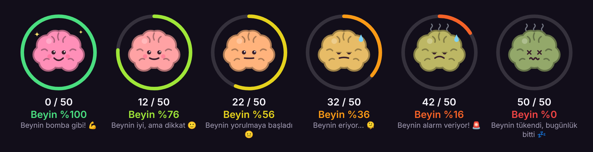
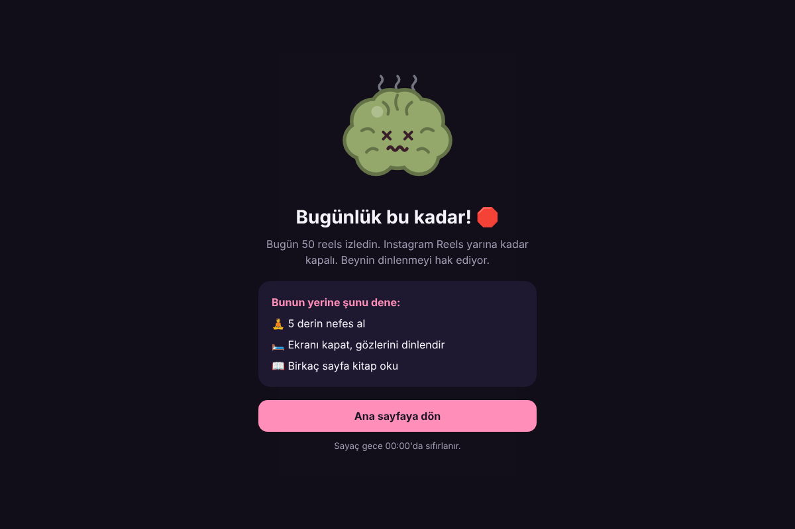
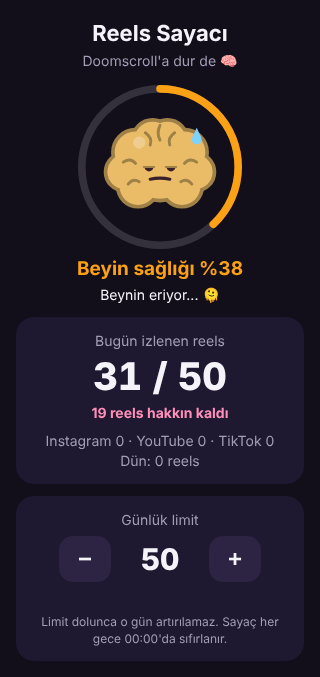

# Reels Sayacı 🧠

Doomscroll'a dur de. **Instagram Reels**, **YouTube Shorts** ve **TikTok**'ta kaç video izlediğini sayar,
yanında bir beyin gösterir. Kaydırdıkça beyin yorulur. **50 reels** dolunca bu ekranlar o gün için kapanır.

- **Sayaç + beyin:** Reels/Shorts/TikTok açıkken ekranın köşesinde `23 / 50` yazar, yanında beyin durur.
  Beyin sağlığı %100'den başlar, her reels ile düşer, 50'de %0 olur.
- **50'den sonra kapanır:** 50. reels'i izleyebilirsin. Bir sonrakine kaydırınca uygulama ana ekrana döner
  ve "Bugünlük bu kadar!" ekranı açılır.
  - Instagram'da sadece **Reels** kapanır. Mesajlar ve ana akış açık kalır.
  - YouTube'da sadece **Shorts** kapanır. Normal videolar açık kalır.
  - **TikTok** tamamen kapanır.
- **Hile yok:** Limit dolunca o gün limiti artıramazsın, sadece azaltabilirsin.
- **Her gece 00:00'da** sayaç sıfırlanır.
- **Gizlilik:** Uygulamanın internet izni yok. Hiçbir veri telefonundan dışarı çıkmaz.

 

## 📱 Telefona kurulum (Android)

1. Telefonundan **[ReelsSayaci.apk](https://github.com/kadrajsosyalmedya/Reels-sayaci/releases/latest/download/ReelsSayaci.apk)** dosyasını indir.
   (Ya da [Releases](https://github.com/kadrajsosyalmedya/Reels-sayaci/releases) sayfasındaki en son sürümü kullan.)
2. İndirilen dosyaya dokun ve kur. "Bilinmeyen uygulamalar" uyarısı çıkarsa tarayıcına izin ver.
3. **Reels Sayacı** uygulamasını aç ve **Sayacı aç** düğmesine bas.
4. Açılan Erişilebilirlik listesinde **Reels Sayacı**'nı bul ve aç.
5. Bu kadar. Instagram Reels'e girince sol tarafta beyin ve sayaç belirecek.

> **"Kısıtlanmış ayar" uyarısı mı çıktı?** Android 13 ve üstünde, internetten indirilen uygulamalarda olur.
> **Ayarlar → Uygulamalar → Reels Sayacı** sayfasına git (uygulamadaki **Uygulama bilgisi** düğmesi de oraya götürür),
> sağ üstteki **⋮** menüsünden **Kısıtlanmış ayarlara izin ver**'i seç, sonra 4. adımı tekrarla.

> Xiaomi, Huawei, Oppo gibi bazı telefonlar pil tasarrufu için arka plandaki servisleri kapatabilir.
> Sayaç kendi kendine kapanıyorsa pil ayarlarından Reels Sayacı için kısıtlamayı kaldır.

## 💻 Bilgisayara kurulum (Chrome, Edge, Brave, Opera)

1. [Releases](https://github.com/kadrajsosyalmedya/Reels-sayaci/releases) sayfasından `ReelsSayaci-eklenti.zip` dosyasını indir ve bir klasöre çıkar.
2. Tarayıcıda `chrome://extensions` adresini aç (Edge'de `edge://extensions`).
3. Sağ üstten **Geliştirici modu**'nu aç.
4. **Paketlenmemiş öğe yükle** düğmesine bas ve çıkardığın klasörü seç.

Eklenti instagram.com/reels, youtube.com/shorts ve tiktok.com sayfalarında çalışır. Simgesine tıklayınca beyin,
sayaç ve limit ayarı açılır.

## 🍏 iPhone?

iOS, başka uygulamaların ekranını okuyan uygulamalara izin vermiyor. Bu yüzden bu uygulama iPhone'da çalışmaz.
Bunun yerine **Ayarlar → Ekran Süresi → Uygulama Sınırları**'ndan Instagram, YouTube ve TikTok'a günlük süre koyabilirsin.

## Nasıl çalışıyor?

**Android:** Uygulama bir Erişilebilirlik servisi kullanıyor. Instagram, YouTube ya da TikTok açıkken ekranın
reels/shorts ekranı olup olmadığına bakar (`clips_viewer…`, `reel_recycler…` gibi görünüm kimlikleriyle).
Tam ekran video akışında her yeni videoya geçişi bir kez sayar. Geri kaydırıp eski videoya dönmek sayılmaz.
Yarım bırakılan kaydırma da sayılmaz. Limit dolunca ana ekrana döner ve engel ekranını açar.

**Eklenti:** Instagram ve YouTube'da adres çubuğundaki reels/shorts kimliği değiştikçe sayar. TikTok'ta ise
ekranda oynayan video değiştikçe sayar.

> Instagram, YouTube ve TikTok güncellemelerle ekranlarını değiştirebilir. Sayaç bir uygulamada saymayı bırakırsa
> GitHub'da bir issue aç.

## Geliştirme

| Klasör | İçerik |
|---|---|
| `android/` | Android uygulaması (Java, ek kütüphane yok). `./gradlew testDebugUnitTest assembleRelease` |
| `extension/` | Tarayıcı eklentisi (Manifest V3) |
| `.github/workflows/build.yml` | Her push'ta testleri çalıştırır, APK'yı ve eklentiyi derleyip Releases'e koyar |

APK, depodaki `android/app/reels-sayaci.keystore` anahtarıyla imzalanır. Böylece yeni sürümler eskisinin üstüne
sorunsuz kurulur. Bu anahtar gizli değildir, kişisel kullanım içindir.
